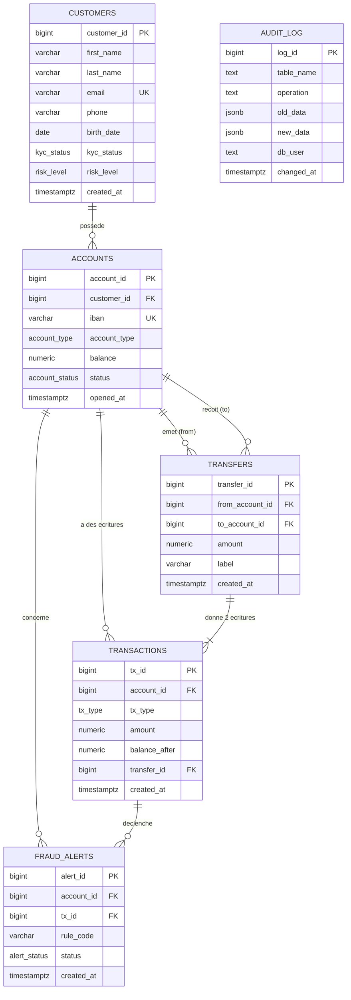

# NovaBank Core
 
Base de données PostgreSQL d'une banque en ligne, construite de zéro sur une VM Ubuntu Server.
 
Projet individuel du module **SQL avancé & administration PostgreSQL** (Bachelor 2).
 
| | |
|---|---|
| Système | Ubuntu Server 26.04 (VirtualBox, sans Docker) |
| SGBD | PostgreSQL 18.6 |
| Langages | SQL, PL/pgSQL, Bash |
| Volume | 50 000 clients, 100 000 comptes, 200 000 virements, **1 000 000 d'écritures** |
 
---
 
## 1. Ce que fait le projet
 
Le prototype de NovaBank a eu trois problèmes. Cette base les rend impossibles :
 
| Problème du prototype | Solution dans la base | Preuve |
|---|---|---|
| Un employé a exporté tous les emails : il avait trop de droits | 4 profils avec le minimum de droits, personne ne lit `customers` directement, vue masquée pour le support | `e3_02`, `e3_03`, `e4_01` |
| Deux virements simultanés ont donné un solde négatif | procédure transactionnelle, verrous `FOR UPDATE` pris dans l'ordre des comptes, `CHECK (balance >= 0)`, trigger qui recalcule le solde | `e7_03`, `e7_04`, `e2_03` |
| L'historique d'un compte mettait plus de 4 s à s'afficher | index `(account_id, created_at DESC)` | `e5` : de 55 ms à 0,25 ms |
 
---
 
## 2. Tout refaire, dans l'ordre
 
### Prérequis
 
- une VM Ubuntu Server avec une carte NAT et une carte host-only en IP fixe (`192.168.56.10`) ;
- un accès SSH ;
- ce dépôt cloné dans `~/novabank`.
### Commandes
 
```bash
cd ~/novabank
 
sudo ./scripts/01_install.sh
 
./scripts/03_rebuild.sh
 
sudo -u postgres psql -d bankdb < tests/e8_tests.sql
 
./scripts/02_backup_restore.sh
```
 
| Étape | Script | Lancé avec | Ce qu'il fait |
|---|---|---|---|
| 1 | `scripts/01_install.sh` | `sudo` | installe PostgreSQL, `ufw`, écrit les réglages (`conf.d`) et `pg_hba.conf`, configure le pare-feu. Relançable sans erreur |
| 2 | `scripts/03_rebuild.sh` | **sans** `sudo` | demande `OUI`, supprime la base puis les rôles, rejoue `sql/00` à `sql/09` avec le bon utilisateur, fait définir les mots de passe avec `\password` |
| 3 | `tests/e8_tests.sql` | `postgres` | tous les tests dans une transaction annulée à la fin : la base n'est pas modifiée |
| 4 | `scripts/02_backup_restore.sh` | **sans** `sudo` | `pg_dump -Fc`, restauration dans une base temporaire, comparaison des comptages et du total des soldes |
 
Aucun mot de passe n'est stocké dans le dépôt. Ils sont saisis avec `\password` pendant la reconstruction.
 
---
 
## 3. Organisation des fichiers
 
```
novabank/
├── README.md
├── .gitignore               secrets, sauvegardes, exports, venv
├── .gitattributes           fins de ligne Unix (LF) forcées
├── scripts/
│   ├── 01_install.sh        installation et configuration du serveur
│   ├── 02_backup_restore.sh sauvegarde + restauration vérifiée
│   └── 03_rebuild.sh        script « tout refaire »
├── sql/                     rejoués dans l'ordre par 03_rebuild.sh
│   ├── 00_init.sql          rôle bank_owner et base bankdb        (postgres)
│   ├── 01_schema.sql        schémas, types, 6 tables, contraintes (bank_owner)
│   ├── 02_data.sql          génération de 1 000 000 d'écritures   (bank_owner)
│   ├── 03_check.sql         contrôles de cohérence : 0 ligne      (bank_owner)
│   ├── 04_roles.sql         groupes, comptes, accès à la base     (postgres)
│   ├── 05_grants.sql        droits sur schémas et tables          (bank_owner)
│   ├── 06_views.sql         vue masquée, modifiable, enregistrée  (bank_owner)
│   ├── 07_indexes.sql       4 index                               (bank_owner)
│   ├── 08_triggers.sql      solde, immuabilité, fraude, audit     (bank_owner)
│   └── 09_procedures.sql    virement, ouverture, relevé           (bank_owner)
├── tests/
│   ├── e5_explain.sql       mesures EXPLAIN avant / après index
│   ├── e6_triggers.sql      tests des triggers
│   ├── e7_procedures.sql    tests des procédures
│   ├── e8_tests.sql         tous les tests (réussite + échec par règle)
│   └── e8_resultats.txt     sortie complète des tests
├── captures/                captures d'écran du terminal
└── backups/                 sauvegardes .dump (non versionné)
```
 
---
 
## 4. Le serveur (E1)
 
**Réglages** (`/etc/postgresql/18/main/conf.d/novabank.conf`) :
 
| Réglage | Valeur | Raison |
|---|---|---|
| `listen_addresses` | `localhost,192.168.56.10` | écoute seulement sur la VM et le réseau d'administration, jamais sur la carte NAT |
| `password_encryption` | `scram-sha-256` | stockage des mots de passe le plus sûr |
| `log_connections` / `log_disconnections` | `on` | chaque connexion est tracée |
| `log_statement` | `ddl` | chaque `CREATE` / `ALTER` / `DROP` est tracé |
 
**`pg_hba.conf`**, lu de haut en bas, première règle qui correspond :
 
| Qui | D'où | Méthode |
|---|---|---|
| `postgres` | socket local | `peer` |
| `bank_owner`, `app_user` | la VM seulement (socket, `127.0.0.1`, `::1`) | `scram-sha-256` |
| membres de `g_analyst`, `g_support`, `g_auditor` | réseau `192.168.56.0/24` | `scram-sha-256` |
| tout le reste | partout | `reject` |
 
**Pare-feu `ufw`** : SSH autorisé (avant `enable`), port 5432 ouvert seulement à `192.168.56.0/24`.
 
---
 
## 5. Les tables (E2)
 

 
`audit.audit_log` est dans un schéma séparé (`audit`) ; les cinq autres tables sont dans `core`.
 
**Choix de types** : `GENERATED ALWAYS AS IDENTITY` pour les identifiants, `numeric(14,2)` pour l'argent (exact au centime, jamais de `float`), `timestamptz` pour les dates, `ENUM` pour les listes fermées. Dans `transactions`, le montant est **signé** (+ entrée, − sortie) pour que le solde soit une simple somme cumulée.
 
### Où est protégée chaque règle
 
| Règle du sujet | Protection | Pourquoi ce choix |
|---|---|---|
| Email unique et valide | `UNIQUE` + `CHECK` (expression régulière, minuscules) | ne dépend que de la ligne |
| Client majeur | **trigger** `fn_customer_adult` | dépend de la date du jour, or un `CHECK` doit toujours donner le même résultat |
| Solde jamais sous 0 | `CHECK (balance >= 0)` + trigger de solde | ne dépend que de la ligne ; le trigger donne un message clair |
| IBAN unique | `UNIQUE` + `CHECK` de format | |
| Montant positif, comptes différents | `CHECK` | ne dépend que de la ligne |
| Grand livre jamais modifié ni supprimé | **triggers** `BEFORE UPDATE/DELETE` (par ligne) et `BEFORE TRUNCATE` (par instruction) | un `CHECK` ne voit pas les modifications |
| Un virement = 2 écritures ou aucune | **procédure** `sp_transfer` (une seule transaction) + `CHECK` liant type et `transfer_id` | concerne plusieurs lignes |
| Alerte retrait ≥ 5 000 ou 5 virements en 10 min | **trigger** `AFTER INSERT` `fn_tx_fraud` | doit compter d'autres lignes |
| Changements notés | **trigger** `fn_audit` (une fonction, trois tables) | |
 
### Génération des données
 
1. clients, puis comptes (2 par client), puis virements, avec `generate_series`, `random()` et `setseed(0.42)` pour des données **reproductibles** ;
2. toutes les écritures dans une table temporaire : **un dépôt d'ouverture par compte** (10 000 à 60 000 €, daté de l'ouverture), 2 écritures par virement, des dépôts et des retraits **après** l'ouverture ;
3. insertion triée par date, avec `balance_after` calculé par la fonction de fenêtre `sum(amount) OVER (PARTITION BY account_id ORDER BY created_at, amount DESC ROWS UNBOUNDED PRECEDING)` ;
4. solde de chaque compte = dernier `balance_after` ;
5. `03_check.sql` vérifie solde = dernier `balance_after` = somme des écritures, 2 écritures par virement qui s'annulent, aucun solde négatif : **0 ligne**.
Le dépôt d'ouverture placé en premier évite qu'un compte parti de 0 devienne négatif au premier retrait. Les données sont chargées **avant** la création des triggers, qui ne ralentissent donc pas le chargement.
 
---
 
## 6. Les droits de chaque rôle (E3)
 
Groupes `NOLOGIN` qui portent les droits, et un compte `LOGIN` membre de chaque groupe :
 
| Groupe | Compte | `statement_timeout` |
|---|---|---|
| `g_analyst` | `analyst1` | 30 s |
| `g_support` | `support1` | 5 s |
| `g_auditor` | `auditor1` | 60 s |
| `g_app` | `app_user` | 3 s |
 
`bank_owner` possède tous les objets ; il n'est **pas** super-administrateur.
 
| Objet | analyste | support | auditeur | application |
|---|:---:|:---:|:---:|:---:|
| `core.customers` | – | – | – | – |
| `core.accounts` | lecture | lecture | lecture | – |
| `core.transfers` | lecture | – | lecture | – |
| `core.transactions` | lecture | – | lecture | – |
| `core.fraud_alerts` | – | – | lecture | – |
| `audit.audit_log` | – | – | lecture | – |
| `core.v_customers_masked` | lecture | lecture | – | – |
| `core.v_accounts_support` | – | lecture + `UPDATE (status)` | – | – |
| `core.mv_monthly_stats` | lecture | – | lecture | – |
| `core.sp_transfer` | – | – | – | `EXECUTE` |
| `core.sp_open_account` | – | – | – | `EXECUTE` |
| `core.fn_statement` | – | `EXECUTE` | – | `EXECUTE` |
 
- Personne n'écrit directement dans les tables : toute écriture passe par une procédure.
- `REVOKE ALL ON DATABASE bankdb FROM PUBLIC` et `REVOKE ALL ON SCHEMA public FROM PUBLIC`.
- `ALTER DEFAULT PRIVILEGES ... REVOKE EXECUTE ON FUNCTIONS FROM PUBLIC` : une nouvelle fonction n'est appelable par personne tant qu'on ne l'a pas autorisée.
- Trois portes : `CONNECT` sur la base, `USAGE` sur le schéma, droit sur l'objet.
- `statement_timeout` est posé sur les **comptes** : un réglage posé sur un groupe n'est pas hérité.
---
 
## 7. Les vues (E4)
 
| Vue | But |
|---|---|
| `v_customers_masked` | email `c***@novabank.fr`, nom réduit à l'initiale, 2 derniers chiffres du téléphone, année de naissance seulement, identifiant pseudonyme `md5(email)`. `security_barrier = true` |
| `v_accounts_support` | le support gèle ou dégèle un compte ; `WITH LOCAL CHECK OPTION` refuse `CLOSED` (la ligne sortirait de la vue) ; le solde n'est pas dans la vue |
| `mv_monthly_stats` | statistiques mensuelles précalculées ; index unique pour `REFRESH MATERIALIZED VIEW CONCURRENTLY` |
 
---
 
## 8. Les index et leurs mesures (E5)
 
Mesures `EXPLAIN (ANALYZE, BUFFERS)` sur 1 000 000 d'écritures, deuxième exécution (cache chaud) :
 
| Requête | Index | Avant | Après | Gain |
|---|---|---|---|---|
| Relevé d'un compte trié par date | B-tree `(account_id, created_at DESC)` | Parallel Seq Scan, 55,5 ms, 9 744 blocs | Bitmap Index Scan, 0,25 ms, 15 blocs | × 220 |
| Recherche d'email insensible à la casse | B-tree sur `lower(email)` | Seq Scan, 27,1 ms, 667 blocs | Index Scan, 0,06 ms, 4 blocs | × 420 |
| Comptes gelés (2 %) | partiel `WHERE status = 'FROZEN'` | Seq Scan, 13,1 ms, 2 371 blocs | Index Scan, 3,9 ms, 999 blocs | × 3 |
| Somme sur un mois | BRIN sur `created_at` | Parallel Seq Scan, ≈ 76 ms, 9 757 blocs | Bitmap Heap Scan, ≈ 12,6 ms, 520 blocs | × 6 |
 
| Index | Taille |
|---|---|
| `ix_tx_account_created` (B-tree) | 30 MB |
| `ix_customers_email_lower` | 2 MB |
| `ix_accounts_frozen` (partiel) | 64 kB |
| `brin_tx_created` (BRIN) | 24 kB |
 
**Observations**
 
- L'index `UNIQUE (email)` n'a jamais servi (`idx_scan = 0`) : la requête contient `lower(email)`, l'index doit être écrit comme la requête.
- Une clé étrangère ne crée pas d'index du côté qui pointe : avant l'index n°1, chercher les écritures d'un compte lisait toute la table.
- BRIN est 1 250 fois plus petit que le B-tree parce que les écritures sont insérées dans l'ordre des dates ; il est approximatif (`lossy`) et revérifie les lignes.
- **Index inutile** : un index sur `tx_type` (4 valeurs, `DEPOSIT` = 35 % des lignes) pèse 6,8 MB et le planificateur l'ignore (`Seq Scan`) : lire la table entière coûte moins cher. Il a été supprimé.
---
 
## 9. Les triggers (E6)
 
| Trigger | Table | Moment | Rôle |
|---|---|---|---|
| `trg_transactions_before_insert_balance` | `transactions` | BEFORE INSERT | verrouille le compte (`FOR UPDATE`), refuse si non actif ou si le solde passe sous 0, calcule `balance_after`, met à jour `accounts.balance` |
| `trg_transactions_before_update_delete_immutable` | `transactions` | BEFORE UPDATE / DELETE | refuse |
| `trg_transactions_before_truncate_immutable` | `transactions` | BEFORE TRUNCATE (par instruction) | refuse |
| `trg_audit_log_before_*_immutable` | `audit_log` | BEFORE UPDATE / DELETE / TRUNCATE | le journal lui-même est immuable |
| `trg_transactions_after_insert_fraud` | `transactions` | AFTER INSERT | alerte `BIG_WITHDRAWAL` (retrait ≥ 5 000) ou `TRANSFER_BURST` (5 virements sortants en 10 min) |
| `trg_*_after_write_audit` | `customers`, `accounts`, `fraud_alerts` | AFTER INSERT / UPDATE / DELETE | une seule fonction : `TG_TABLE_NAME`, `TG_OP`, `to_jsonb(OLD)`, `to_jsonb(NEW)`, `session_user` |
| `trg_customers_before_write_adult` | `customers` | BEFORE INSERT / UPDATE OF birth_date | refuse un client mineur |
 
La fonction d'audit est `SECURITY DEFINER` (personne n'a le droit d'écrire dans le journal à la main) avec `search_path` fixé. Elle enregistre `session_user`, le vrai compte connecté, et non `current_user`, qui vaudrait `bank_owner` dans une fonction `SECURITY DEFINER`.
 
---
 
## 10. Les procédures (E7)
 
| Objet | Contrôles | Effet |
|---|---|---|
| `CALL core.sp_transfer(from, to, montant, libellé, NULL)` | montant positif, 2 décimales au plus, comptes différents, existants, actifs, solde suffisant | 1 virement + 2 écritures, ou rien |
| `CALL core.sp_open_account(client, type, dépôt, NULL, NULL)` | client existant, KYC `VERIFIED`, dépôt valide | compte avec IBAN unique (séquence), dépôt initial éventuel |
| `SELECT * FROM core.fn_statement(compte, nb)` | compte existant, 1 à 500 lignes | relevé avec soldes et libellés |
 
- **Anti-deadlock** : les deux comptes sont verrouillés en une fois, **dans l'ordre croissant des numéros**, quel que soit le sens du virement. Deux virements croisés A→B et B→A demandent le même premier verrou : l'un attend l'autre, sans cercle.
- `SECURITY DEFINER SET search_path = pg_catalog, pg_temp` : l'application n'a aucun droit sur les tables, seule la procédure en a ; le chemin de recherche est verrouillé pour qu'aucun objet piégé ne soit exécuté avec les droits du propriétaire.
- Le trigger calcule déjà le solde : la procédure se contente d'insérer les deux écritures.
---
 
## 11. Tests, sauvegarde (E8)
 
- `tests/e8_tests.sql` : pour chaque règle, un test `[DOIT REUSSIR]` et un test `[DOIT ECHOUER]`, avec `SET ROLE` pour chaque profil. `\set ON_ERROR_STOP off` et `\set ON_ERROR_ROLLBACK on` permettent de continuer après une erreur attendue ; tout est dans une transaction terminée par `ROLLBACK`, donc la base n'est pas modifiée. Sortie complète : `tests/e8_resultats.txt`.
- `scripts/02_backup_restore.sh` : `pg_dump -Fc`, `createdb` d'une base temporaire, `pg_restore`, comparaison des `count(*)` de chaque table **et du total des soldes**. Résultat : identique (30 MB pour 1 000 000 d'écritures).
---

## 12. Captures
 
Toutes dans [`captures sql/`](captures%20sql/).

## 13. Utilisation d'une IA
 
J'ai utilisé Claude pour: 
 
- m'expliquer la configuration réseau de la VM (netplan, IP fixe, carte host-only), la mise en place des clés SSH depuis Windows et la liaison Git / GitHub ;
- m'expliquer chaque notion utilisée : `pg_hba.conf`, CHECK ou trigger, fonctions de fenêtre, les trois portes des droits, `security_barrier`, `CHECK OPTION`, lecture des plans `EXPLAIN`, types d'index, `FOR UPDATE` et interblocages, `SECURITY DEFINER` et `search_path`, `session_user` / `current_user` ;
- m'aider à comprendre et corriger les erreurs rencontrées (shebang manquant lancé par `dash`, `ANALYZE` sur les tables système, ordre des lignes sans `ORDER BY` dans le script de sauvegarde, `TRUNCATE` bloqué par la clé étrangère avant le trigger).
- m'aider à la rédaction de ce Readme
